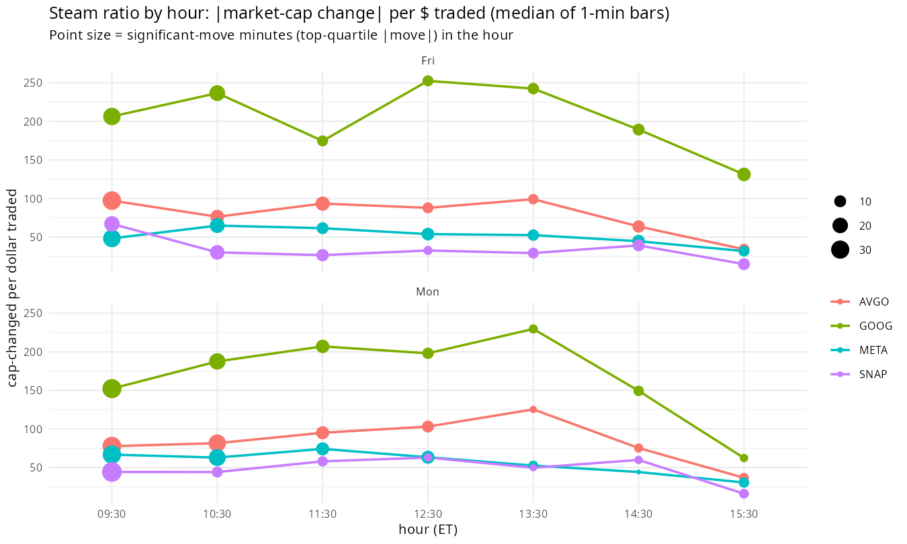
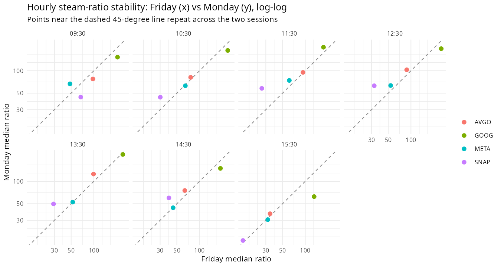
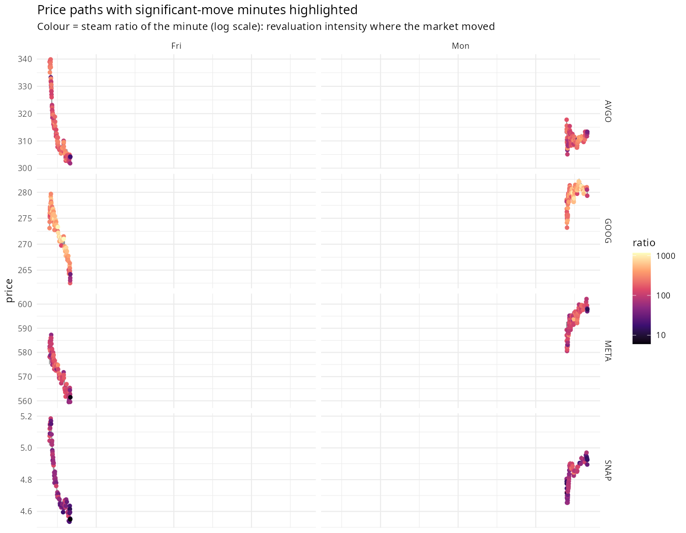
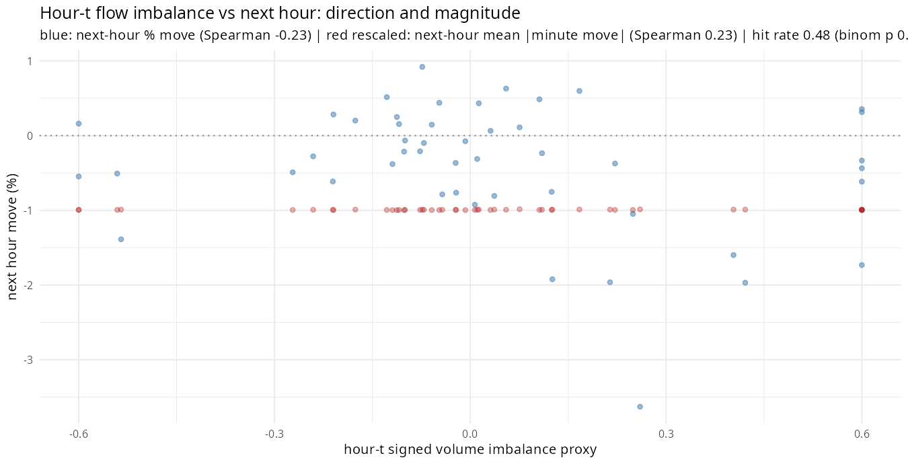

Educational market analysis. Not investment advice. All figures are computed in R from Yahoo Finance v8 chart data saved under `data/`; scripts are under `scripts/`.

## Summary

- Friday Nov 20 was a repricing, not a liquidation. The four primary stocks lost about $379B of combined market capitalization (computed in `R/07_sums_doc1.R`) while about $44B of those stocks traded (daily volume times typical price). The worst minute for GOOG, META, SNAP and NVDA was 15:55, with volume 4.9x to 10.7x a median minute; every one of the five closed in the bottom 3% to 9% of its day's range.
- Monday Nov 23 recovered about 87% of that four-stock cap loss at the close, but the recovery was not uniform. It arrived almost entirely as an overnight gap, and the shape of the intraday session split the group: AVGO gave back its whole gap within 17 minutes and closed +3.00% close-over-close (retracing 22% of its Friday drop), while GOOG, META and NVDA closed above their Thursday levels.
- The two "conflicting" Monday readings for NVDA (+31% in the news, -1.19% in Yahoo dailies) are both correct. They measure different things: close-over-close is +31.48%, open-to-close is -1.19%, and the difference is a +33.07% opening gap.
- One of the brief's anchors does not survive contact with the raw data: AVGO's Friday close is 304.41, not 340.20. On the correct basis AVGO gapped up +5.40% on Monday, not down -5.7%. Details in the reconciliation section.
- The "steam" ratio (absolute market-cap change per dollar traded, per minute) is nearly the same on Monday as on Friday for every stock. It behaves like a structural property of how capitalization is marked, not a Friday-specific stress signal. The hourly-resolution tests below sharpen this: the per-stock amplification is a standing property with a stable intra-day profile, and what the crisis changed was not the physics but the flow pushing through it. It does not predict hour-to-hour price direction (tested, rejected), though Friday-afternoon continuation across the whole group is visible in window sums.
- 
- 
- 
- 
- By the Yahoo snapshot at about 13:50 ET on Tuesday Nov 24 (not a close), NVDA was -6.95% from Monday's close and AVGO -3.08%, with AVGO back to within 0.17% of its Friday close.

## Data and method

- Source: Yahoo Finance v8 chart endpoint (https://query1.finance.yahoo.com/v8/finance/chart/). Monday 1-minute bars for AVGO, GOOG, META, SNAP and NVDA, Friday NVDA 1-minute bars, and daily bars for the five stocks plus ^GSPC, ^VIX and ^TNX covering Nov 16 to Nov 24.
- Fetch discipline: period1 and period2 were computed as epoch seconds from the exact New York dates (`scripts/fetch_nov23.sh`); `R/00_verify_data.R` confirms every file's first timestamp maps to the intended date (Mon files start 2026-11-23 09:30 ET; Friday files 2026-11-20 09:30 ET). Yahoo returned HTTP 429 to the first attempts (Python urllib, and curl with a Linux user agent); curl with a Windows-style browser user agent then succeeded for every file.
- Friday AVGO, GOOG, META, SNAP bars are John's files already on disk (391 bars, 09:30 to 16:00). The Monday bars have 390 bars (09:30 to 15:59); Yahoo had no 16:00 bar for Monday at fetch time.
- Market capitalization uses the shares in the brief: AVGO 4.77B; META 2.56B; SNAP 1.718B; Alphabet 12,280,813,656 (all share classes valued at the GOOG price, an approximation). No NVDA share count was supplied, so NVDA gets price and volume analysis but no capitalization or ratio.
- Dollars traded in a minute are volume times the bar's mid-price ((high + low) / 2), the method of `temp_calc_flow.R`. Ratio is the absolute capitalization change over that minute divided by dollars traded in it.
- Daily bars are used for official closes. The first 1-minute bar's open and the daily open differ slightly (AVGO Monday 320.64 vs 320.86) because the daily open is the opening-auction print.

## Reconciling the conflicting anchors

### NVDA: +31% and -1.19% are the same day

| Symbol | Fri close | Mon open | Mon close | Gap (close->open) | Intraday (open->close) | Close-over-close |
|---|---:|---:|---:|---:|---:|---:|
| AVGO | 304.41 | 320.86 | 313.55 | +5.40% | -2.28% | +3.00% |
| GOOG | 264.00 | 282.49 | 279.53 | +7.00% | -1.05% | +5.88% |
| META | 560.84 | 591.72 | 597.60 | +5.51% | +0.99% | +6.55% |
| SNAP | 4.55 | 4.90 | 4.92 | +7.69% | +0.41% | +8.13% |
| NVDA | 125.53 | 167.04 | 165.05 | +33.07% | -1.19% | +31.48% |
| S&P 500 | 6,910.39 | 7,227.41 | 7,237.17 | +4.59% | +0.14% | +4.73% |

NVDA's Friday close was 125.53 (daily; the last 1-minute bar prints 125.79). Monday opened at 167.04 and closed at 165.05. Close-over-close that is +31.48%, which matches the news figure of about +31%. Open-to-close it is -1.19%, which matches the Yahoo daily anchor. The gap from 125.53 to 167.04 is +33.07%, so the gap is 105% of the full close-over-close move: after the open, NVDA gave back a little. The S&P 500 shows the same structure at lower amplitude: +4.73% close-over-close (the news figure), of which the +4.59% gap is 97%.

The brief attributes the NVDA gap to Huang being reinstated as CEO. That is relayed from the task note; this analysis did not verify the news item. The Friday move is described in the harness notes as a reaction to a Reuters report of an SEC accounting review; also not verified here.

### AVGO: the Friday close in the brief does not reproduce

The brief gives AVGO's Friday close as 340.20 and derives a Monday gap of -5.7% and a close-over-close move of -7.8%. The raw data do not support that:

- Yahoo's daily bar for Fri Nov 20 has close 304.41, and the last Friday 1-minute bar (16:00) also closes at 304.41.
- No Friday 1-minute AVGO bar closes between 340.00 and 340.50. Friday's daily open was 343.01 and its high 343.01.
- Thursday's close was 346.65. A Friday close of 340.20 would imply a -1.9% day; the daily data and the 1-minute data both show -12.19%.

The Monday anchors in the brief (open 320.86, close 313.55) match the daily data exactly. Against a Friday close of 304.41 they give a gap of +5.40%, an intraday move of -2.28% and a close-over-close move of +3.00%. The brief's qualitative point that AVGO did not rebound like the others stands, but its sign is different: AVGO rose close-over-close (+3.00%) and fell open-to-close (-2.28%); it was the weakest of the group, not a faller on the day. I could not find the origin of 340.20 in the data. Nicole should confirm where it came from.

All other anchors in the brief match the daily bars: GOOG 282.49 to 279.53, META 591.72 to 597.60, SNAP 4.90 to 4.92, NVDA 167.04 to 165.05, GSPC 7227.41 to 7237.17. The brief's Friday closes for GOOG, META, SNAP and NVDA, which were to be fetched, are 264.00, 560.84, 4.55 and 125.53.

## Friday Nov 20: repricing without liquidation

### The recomputed table matches CONTEXT.md

| Stock | Minute | Price move | Cap change $B (mine / CONTEXT) | $ traded M (mine / CONTEXT) | Ratio (mine / CONTEXT) |
|---|---:|---:|---:|---:|---:|
| AVGO | gain 09:57 | 333.30 -> 337.00 (+1.11%) | +17.65 / +17.70 | 61.8 / 61.8 | 286x / 286x |
| AVGO | loss 09:55 | 339.87 -> 331.92 (-2.34%) | -37.93 / -37.90 | 144.6 / 144.6 | 262x / 262x |
| GOOG | gain 09:31 | 271.82 -> 274.02 (+0.81%) | +27.02 / +27.00 | 88.2 / 88.2 | 306x / 306x |
| GOOG | loss 15:55 | 264.26 -> 262.50 (-0.67%) | -21.63 / -21.60 | 117.2 / 117.2 | 185x / 185x |
| META | gain 10:20 | 577.34 -> 581.38 (+0.70%) | +10.33 / +10.30 | 74.1 / 74.1 | 139x / 139x |
| META | loss 15:55 | 562.67 -> 559.53 (-0.56%) | -8.05 / -8.00 | 135.7 / 135.7 | 59x / 59x |
| SNAP | gain 15:45 | 4.53 -> 4.61 (+1.77%) | +0.14 / +0.14 | 2.6 / 2.6 | 54x / 54x |
| SNAP | loss 15:55 | 4.59 -> 4.55 (-0.87%) | -0.07 / -0.07 | 4.5 / 4.5 | 15x / 15x |

Every row reproduces the CONTEXT.md table: the maximum difference in the rounded ratio is zero, and the dollars traded match to the first decimal. The small differences in capitalization change (for example +17.65 vs +17.70) are rounding in the earlier table, not a difference of method. No Friday figure needed correcting.

### What the day looked like

- Magnitude: close-over-close, AVGO -12.19%, GOOG -2.59%, META -5.93%, SNAP -11.13%, NVDA -14.01%, S&P 500 -3.70%. From the Nov 16 open to the Friday close the S&P fell 8.03% (the harness notes quote -8.6% for the week, which starts a day earlier than my data and is not reproduced here).
- Close-weighted: every stock closed in the bottom 3% to 9% of its day range. The day's low came at 15:59 for AVGO, 15:56 for GOOG and NVDA, 15:35 for META and 15:31 for SNAP.
- The 15:55 minute: it was the single largest 1-minute loss for GOOG (-0.67%), META (-0.56%), SNAP (-0.87%) and NVDA (-1.74%). AVGO's largest loss was at 09:55 (-2.34%), though it also fell 0.83% at 15:55. The pattern is consistent with a closing-auction imbalance (selling that must execute at the close), but 1-minute bars cannot show the imbalance itself, so this stays a consistent-with reading, not a finding.

| Stock | Day | 15:55 return | 15:55 volume / median minute |
|---|---:|---:|---:|
| AVGO | Fri | -0.826% | 7.5x |
| AVGO | Mon | +0.185% | 3.7x |
| GOOG | Fri | -0.666% | 8.0x |
| GOOG | Mon | -0.236% | 7.5x |
| META | Fri | -0.559% | 6.0x |
| META | Mon | -0.143% | 4.4x |
| SNAP | Fri | -0.871% | 10.7x |
| SNAP | Mon | -0.407% | 4.6x |
| NVDA | Fri | -1.737% | 4.9x |
| NVDA | Mon | -0.052% | 2.4x |

- VIX closed at 35.89 after trading as high as 40.03; the 10-year yield (^TNX) closed at 4.912%, down from 5.052% on Thursday. Falling yields alongside a falling stock market is consistent with a flight to safety rather than a rate shock.
- Staples: the harness notes record that staples were the only rising sector on Friday. I did not fetch sector data, so that claim is carried from CONTEXT.md unverified.

### Repricing, in dollars

| Stock | Day | Cap before $B | Cap after $B | Change $B | Session $ traded B (daily vol x typical px) | Abs change / $ traded |
|---|---:|---:|---:|---:|---:|---:|
| AVGO | Fri | 1,654 | 1,452 | -201.5 | 19.00 | 10.6x |
| AVGO | Mon | 1,452 | 1,496 | +43.6 | 12.88 | 3.4x |
| GOOG | Fri | 3,328 | 3,242 | -86.2 | 10.34 | 8.3x |
| GOOG | Mon | 3,242 | 3,433 | +190.7 | 8.74 | 21.8x |
| META | Fri | 1,526 | 1,436 | -90.6 | 14.63 | 6.2x |
| META | Mon | 1,436 | 1,530 | +94.1 | 11.30 | 8.3x |
| SNAP | Fri | 9 | 8 | -1.0 | 0.29 | 3.4x |
| SNAP | Mon | 8 | 8 | +0.6 | 0.21 | 3.0x |

On Friday the four stocks together lost about $379B of capitalization. AVGO alone lost $201.5B against roughly $19B of stock traded that session, a ratio near 11x. The stock that changed hands is a small fraction of the value that was re-marked, which is the sense of "repricing without liquidation": almost none of the lost value was converted to cash by a holder; it was the marginal price moving and carrying every unsold share with it. (Session dollars here are daily volume times (high + low + close)/3, because the 1-minute volumes do not reconcile with the daily volumes; see the data-quality section.)

## Monday Nov 23: what the relief rally did

### The recovery was a gap, and it was uneven

| Stock | Open vs Fri close | High (time) | Low (time) | Last bar close vs Fri close | Close vs day high | Close in day range | Shares in first 30 min |
|---|---:|---:|---:|---:|---:|---:|---:|
| AVGO | +5.33% | 324.44 @09:31 (+6.6%) | 304.56 @09:47 (+0.0%) | +3.00% | -3.36% | 45% | 9% |
| GOOG | +7.00% | 282.62 @13:25 (+7.1%) | 273.00 @09:41 (+3.4%) | +5.94% | -1.04% | 70% | 38% |
| META | +5.52% | 602.46 @15:48 (+7.4%) | 579.78 @09:41 (+3.4%) | +6.61% | -0.76% | 80% | 22% |
| SNAP | +7.69% | 4.97 @15:33 (+9.2%) | 4.65 @09:40 (+2.2%) | +8.02% | -1.11% | 83% | 27% |
| NVDA | +33.07% | 171.50 @10:25 (+36.6%) | 156.93 @09:41 (+25.0%) | +31.59% | -3.68% | 57% | 12% |

- All five opened between +5.3% and +33.1% above Friday's close, then spent the day inside a range. GOOG, META and SNAP closed at 70% to 83% of their day's range after a pullback from the open; AVGO closed at 45% of its range; NVDA at 57%.
- AVGO opened at 320.64, printed its high of 324.44 at 09:31, and was down to 304.56 at 09:47, which is 15 cents above its Friday close of 304.41. The entire gap was erased in 17 minutes. It then rallied to close at 313.54 (+3.00% on the day against Friday's close).
- Early-session volume differed: GOOG traded 38% of the day's 1-minute shares in the first 30 minutes, SNAP 27%, META 22%, NVDA 12% and AVGO 9%. The AVGO share is distorted by two oversized mid-session bars (see the data-quality section), so it should not be over-read.

### How much of Friday came back

| Symbol | Thu close | Fri close | Fri chg | Mon close | Share of Fri drop retraced | Mon close vs Thu close | Mon close vs Nov 16 close |
|---|---:|---:|---:|---:|---:|---:|---:|
| AVGO | 346.65 | 304.41 | -12.19% | 313.55 | 22% | -9.55% | -5.95% |
| GOOG | 271.02 | 264.00 | -2.59% | 279.53 | 221% | +3.14% | -0.62% |
| META | 596.22 | 560.84 | -5.93% | 597.60 | 104% | +0.23% | -4.60% |
| SNAP | 5.12 | 4.55 | -11.13% | 4.92 | 65% | -3.91% | -3.34% |
| NVDA | 145.98 | 125.53 | -14.01% | 165.05 | 193% | +13.06% | +5.71% |
| S&P 500 | 7,175.83 | 6,910.39 | -3.70% | 7,237.17 | 123% | +0.85% | -2.42% |

- GOOG (221%), NVDA (193%), S&P 500 (123%) and META (104%) more than reversed Friday's drop; SNAP retraced 65%; AVGO retraced 22%. AVGO closed Monday 9.55% below Thursday's close and 5.95% below its Nov 16 close.
- Across the four primary stocks, Monday added about $329B of capitalization against Friday's loss of about $379B (87%). Alphabet's weight in that sum is large: its +$190.7B is 58% of the Monday total, so a four-stock aggregate mostly tracks GOOG.
- The retracement metric is sensitive to the size of Friday's drop. GOOG fell only 2.59% on Friday, so it takes a modest rally to exceed 100%; AVGO fell 12.19%.

### The steam ratio on Monday

| Stock | Minute | Price move | Cap before -> after $B | Change $B | $ traded M | Ratio | % of shares traded |
|---|---:|---:|---:|---:|---:|---:|---:|
| AVGO | gain 09:36 | 313.31 -> 315.58 (+0.72%) | 1,494.5 -> 1,505.3 | +10.83 | 53.3 | 203x | 0.0036% |
| AVGO | loss 09:39 | 313.40 -> 309.69 (-1.18%) | 1,494.9 -> 1,477.2 | -17.70 | 49.6 | 357x | 0.0033% |
| GOOG | gain 09:41 | 273.19 -> 274.71 (+0.56%) | 3,355.0 -> 3,373.7 | +18.67 | 41.8 | 447x | 0.0012% |
| GOOG | loss 09:35 | 278.23 -> 276.82 (-0.51%) | 3,416.9 -> 3,399.6 | -17.32 | 54.7 | 316x | 0.0016% |
| META | gain 09:31 | 590.55 -> 593.77 (+0.55%) | 1,511.8 -> 1,520.1 | +8.24 | 72.6 | 114x | 0.0048% |
| META | loss 09:34 | 592.69 -> 589.33 (-0.57%) | 1,517.3 -> 1,508.7 | -8.60 | 86.2 | 100x | 0.0057% |
| SNAP | gain 10:01 | 4.74 -> 4.78 (+1.06%) | 8.1 -> 8.2 | +0.09 | 2.3 | 37x | 0.0287% |
| SNAP | loss 09:36 | 4.78 -> 4.72 (-1.15%) | 8.2 -> 8.1 | -0.09 | 1.2 | 80x | 0.0144% |

- Same method as Friday: Monday's largest 1-minute gain and loss for each stock, with capitalization before and after, dollars traded and the ratio. Monday's extreme minutes range from 37x (SNAP) to 447x (GOOG); Friday's ranged from 15x to 306x.
- Timing differs. Friday's extremes included the 15:55 close for three of four stocks; every Monday extreme occurred between 09:31 and 10:01, none at the close. Monday's problem was the open, not the close.
- Across all minutes the distribution is nearly unchanged:

| Stock | Day | Minutes | Median | P90 | P99 | Max |
|---|---:|---:|---:|---:|---:|---:|
| AVGO | Fri | 389 | 80x | 208x | 349x | 437x |
| AVGO | Mon | 389 | 82x | 225x | 380x | 497x |
| GOOG | Fri | 389 | 218x | 537x | 936x | 1171x |
| GOOG | Mon | 389 | 163x | 467x | 920x | 1114x |
| META | Fri | 389 | 52x | 145x | 235x | 329x |
| META | Mon | 389 | 54x | 157x | 257x | 526x |
| SNAP | Fri | 389 | 25x | 79x | 147x | 215x |
| SNAP | Mon | 389 | 28x | 90x | 156x | 254x |

- Median ratios are within 10% of each other between Friday and Monday for AVGO, META and SNAP (80x vs 82x; 52x vs 54x; 25x vs 28x), and about 25% lower on Monday for GOOG (218x vs 163x). The ratio is mostly set by the stock's share count relative to its trading volume, not by the day's mood.
- At the daily level the pattern in the table of capitalization changes shows the largest "steam" on Monday: GOOG's +$190.7B on about $8.7B traded is 21.8x. Most of that capitalization was created by the overnight gap, when only the opening auction trades; the session's cash flow is a poor guide to what happened to value.

## Hourly resolution: is the ratio stable enough to use?

The two-day median comparison above is a low-sample result, and John flagged exactly that (Nov 24): before treating the ratio as a structural constant, test it at every hour of both sessions, against every significant move, and test whether it predicts anything. This section is that test (all in `R/10_hourly_ratio.R`; 2,908 valid 1-minute bars across 8 symbol-days; 7 hourly windows per day, 09:30 to 16:00 ET).

Method: per-minute, revalued dollars are |Δclose| × shares outstanding; the ratio is revalued dollars divided by dollars traded in the same minute (close × volume), the same-minute convention used in the tables above — it reproduces the full-day medians (hourly geometric means 85x / 215x / 54x / 36x for AVGO / GOOG / META / SNAP vs the daily 80x / 218x / 52x / 25x). NVDA is excluded from ratio analysis: no verified share count was available (Yahoo quoteSummary returned no usable sharesOutstanding at run time), so its price and volume analysis stands but its multiplier cannot be computed yet.

### Finding 1: the amplification is per-stock structure, and its intra-day profile repeats

| Stock | Spearman ρ(Fri hourly, Mon hourly) | CV Fri | CV Mon | Median Fri | Median Mon |
|---|---:|---:|---:|---:|---:|
| AVGO | 0.93 | 0.34 | 0.36 | 77x | 82x |
| GOOG | 0.86 | 0.22 | 0.37 | 207x | 177x |
| META | 0.46 | 0.21 | 0.27 | 52x | 66x |
| SNAP | 0.00 | 0.34 | 0.30 | 32x | 51x |

- The hourly ratio profiles track each other across two sessions with opposite moods: AVGO 0.93, GOOG 0.86. That is the strongest form of the stability claim: not just the same median, the same *shape through the day*. META is moderate (0.46); SNAP shows none, and SNAP is also the stock whose Yahoo minute-volume noise is worst — thin instrument, thin data.
- Within any single hour, the minute-level ratio is noisy: the coefficient of variation of minute ratios runs 0.76 to 1.08 across all 8 symbol-days. Stability exists only at hourly aggregation. The right resolution for a ratio gauge is the hour, not the minute.
- Event-conditioned medians (the top quartile of |minute move| only) run 2.4x to 2.8x the hour's baseline on both days and both moods (for example AVGO: 187x/202x event vs 79x/85x baseline). Significant moves are the high-multiplier minutes, but the baseline is already 50x to 200x even in calm: the mechanism does not switch on during stress. It is always on.

### Finding 2: what changed Friday to Monday was the flow, not the vessel

Monday ran roughly 2x Friday's dollar volume with the multipliers essentially unchanged (within 10% for AVGO, META, SNAP; GOOG 25% lower on its calmer session). The larger session capitalization changes were produced by more flow moving through an amplifier of the same gain, and most of Monday's revaluation happened at the open, in the gap, on auction volume. In the steam framing (CONTEXT.md): the containment vessel's amplification is a constant of how the market is plumbed; what a crisis changes is how hard the steam pushes, not the size of the piston. Friday felt like a phase change; measured at hourly resolution, the phase was already boiling and Friday was a flow spike.

Design consequence for the trading harness: the expansion-ratio monitor should baseline each stock against its own trailing hourly median, never against another stock or a crisis day. Cross-stock ratio comparison is confounded by unequal venue coverage in Yahoo's minute volumes (summed 1-minute volume runs 0.72x to 9.85x of daily volume by symbol-day), so ratio *levels* are only comparable within one stock.

### Finding 3: it does not predict hour-to-hour direction (tested, rejected)

The natural trading hypothesis: hours with heavy one-sided flow should carry information into the next hour. Test: signed volume imbalance per hour, sum(volume × sign), as a Spearman predictor of the next hour's return, within symbol, pooled across the 8 symbol-days (n = 48 hour-pairs).

- Pooled directional hit rate: 0.479 (binomial p = 0.89 against coin-flip). Pooled within-symbol correlations: direction +0.09, magnitude -0.14.
- Per-symbol direction correlations: AVGO +0.09, GOOG -0.37, META -0.02, SNAP -0.58 — mixed signs at 12 windows per symbol, exactly what noise looks like.
- A 3-hour window-sum version produced a pooled correlation of -0.74, which looks like a signal and is not. Decomposed, it is a day dummy: 7 of 8 Friday morning windows ran sell-heavy and Friday fell; 12 of 12 Monday morning windows ran buy-heavy and Monday rose. One intraday-persistence observation, counted eight times; per-symbol window counts of 3 flip signs (META Friday +0.87, Monday -1.00). Two sessions cannot separate flow signal from day trend, and no resolution of minute data fixes that: it needs more sessions, not finer bars.

### What would settle it

1. Twenty-plus sessions of per-stock hourly ratios would turn the intra-day profile into an estimable baseline (correlating random day-pairs, not a crisis against a relief day), and give the direction test actual power.
2. Consolidated-tape minute volumes (or broker per-venue data) would cut the volume-noise floor that currently limits ratio precision; Yahoo's venue gaps cap how sharp the multiplier can ever get from this source.
3. If the per-stock multiplier holds its hourly profile across a 20-day panel, the harness's monitor becomes a real thin-book detector: today's hourly median divided by the trailing hourly median, beyond a threshold, flags flow arriving into a thin book — the condition under which any repricing is most steam-per-dollar.

## What Monday did not repair

- AVGO: -9.55% against Thursday's close, with an intraday path that failed at the open and a Tuesday snapshot back within 0.17% of Friday's close.
- Volatility: VIX fell from 35.89 to 26.62 (-9.27 points), but is above its Nov 16 close of 22.91. VIX's Monday intraday low of 15.39 looks like an anomalous print against a 31.38 open and 26.62 close; I have not verified it.

| Date | VIX open | VIX high | VIX low | VIX close | ^TNX close (10y, %) |
|---|---:|---:|---:|---:|---:|
| 2026-11-16 | 20.00 | 24.52 | 19.84 | 22.91 | 5.121 |
| 2026-11-17 | 23.11 | 27.73 | 22.36 | 25.46 | 5.103 |
| 2026-11-18 | 24.22 | 26.26 | 23.45 | 24.56 | 5.066 |
| 2026-11-19 | 22.06 | 29.13 | 21.84 | 28.44 | 5.052 |
| 2026-11-20 | 28.63 | 40.03 | 26.94 | 35.89 | 4.912 |
| 2026-11-23 | 31.38 | 35.08 | 15.39 | 26.62 | 4.918 |

- Index: the S&P 500's Monday close of 7,237.17 is 2.42% below the Nov 16 close of 7,416.59, even after +4.73% on the day.
- Tuesday so far (a Yahoo snapshot at about 13:50 ET, not a close):

| Symbol | Mon close | Tue open | Tue last (snapshot) | Last vs Mon close |
|---|---:|---:|---:|---:|
| AVGO | 313.55 | 300.89 | 303.88 | -3.08% |
| GOOG | 279.53 | 278.70 | 276.01 | -1.26% |
| META | 597.60 | 589.50 | 592.51 | -0.85% |
| SNAP | 4.92 | 4.88 | 4.91 | -0.10% |
| NVDA | 165.05 | 159.06 | 153.59 | -6.95% |
| S&P 500 | 7,237.17 | 7,172.33 | 7,194.80 | -0.59% |
| VIX | 26.62 | 26.52 | 26.36 | -0.26 pts |
| TNX | 4.92 | 4.89 | 4.91 | -0.01 pts |

- NVDA is down 6.95% from Monday's close, giving back about 29% of Monday's close-over-close gain (it is +22.35% against Friday's close at the snapshot). AVGO is down 3.08%, which is 106% of its Monday gain in points. GOOG, META and SNAP are within 1.3% of Monday's close. The high-beta names are fading faster than the others.

## Reading the rest of Thanksgiving week

Calendar facts are from the harness notes (CONTEXT.md, market backdrop) and were not independently verified here: Tuesday consumer confidence; Wednesday core PCE (expected +0.3% m/m) with GDP, durable goods and jobless claims in the 08:15 to 10:30 ET window; Thursday Nov 26 closed; Friday Nov 27 an early close. A December rate hike is described as priced near certain, with the 10-year near 4.9%. Yahoo's ^TNX closed at 4.918% on Monday.

These are observations from the tape, not forecasts:

- Gaps carry the information. On both days most of the move came overnight (NVDA's gap was 105% of its close-over-close move; AVGO's 180%). A strategy that observes the market only during the session sees the aftermath. Wednesday's data are followed by a closed Thursday and a half-day Friday, so a repricing that the data trigger would be absorbed in few and thin sessions.
- Monday's fade in AVGO and NVDA, and Tuesday's continuation, suggest the relief rally was less a re-rating of the group than a repair of its most extreme dislocations. The stocks whose Friday drops were largest (AVGO, NVDA) are the ones giving back Monday's gain fastest.
- The steam ratio is a structural quantity: it will be high in any thin-volume window. A half-day on Friday, and the pre-holiday session on Wednesday, have lower dollar volume, so the same price change will carry more capitalization change per dollar traded. This predicts larger repricing per trade, not a particular direction.
- The harness's gauge: VIX 26.62 and 10-year 4.92% on Monday's close sit inside the "contained" band (VIX under 30, 10-year under 5%); Friday's close (VIX 35.89) was in the "boiling" band. Tuesday's snapshot (VIX 26.36) is still contained. Containment is a statement about the gauge, not about the stocks: AVGO was still 9.55% below Thursday at Monday's close.

## Data quality and limits

| Stock | Day | Sum of 1m volume (M) | Daily volume (M) | Ratio | Largest 1m bar (M) |
|---|---:|---:|---:|---:|---:|
| AVGO | Fri | 73.5 | 60.1 | 1.22 | 29.2 |
| AVGO | Mon | 93.1 | 41.0 | 2.27 | 26.1 |
| GOOG | Fri | 27.8 | 38.5 | 0.72 | 1.3 |
| GOOG | Mon | 29.6 | 31.4 | 0.94 | 3.8 |
| META | Fri | 74.6 | 25.7 | 2.91 | 16.0 |
| META | Mon | 15.7 | 19.1 | 0.82 | 1.4 |
| SNAP | Fri | 134.6 | 61.0 | 2.21 | 43.7 |
| SNAP | Mon | 34.1 | 43.6 | 0.78 | 2.2 |
| NVDA | Fri | 2,892.7 | 633.4 | 4.57 | 362.3 |
| NVDA | Mon | 7,672.9 | 779.2 | 9.85 | 608.9 |

- The 1-minute volumes do not reconcile with Yahoo's daily volumes. The ratio of summed 1-minute volume to daily volume runs from 0.72 to 9.85 across symbol-days. The cause is a handful of oversized bars (for example AVGO Friday 13:34: 29.2M shares in one minute; NVDA Monday 14:24: 608.9M). The extreme-minute events used in this document sit at bars with ordinary volumes, and distribution statistics exclude the 09:30 and 16:00 bars, but session dollars use daily volume for this reason.
- Yahoo's 1-minute volume may miss venues, as the CONTEXT notes say; true ratios are probably lower, but the scale holds.
- No NVDA share count was supplied, so there is no NVDA capitalization analysis.
- Alphabet's capitalization values all share classes at the GOOG price.
- Monday's 1-minute bars end at 15:59; closes in this document use the daily bar, which includes the closing auction.
- Tuesday data are a mid-session snapshot taken at about 13:50 ET and will change.

## Reproducibility

- `scripts/fetch_nov23.sh` (fetch, computed epochs), `R/00_verify_data.R` (date checks), `R/03_analysis.R` (statistics), `R/05_tables_doc1.R` (the tables in this document), `R/06_extras_doc1.R` and `R/07_sums_doc1.R` (the figures quoted in prose), `R/10_hourly_ratio.R` (the hourly-resolution stability and predictability tests, and all four figures under `docs/figs/`).
- v2 revision (Nicole, Nov 24): versioned as `docs/selloff-nov20-recovery-nov23-v2.qmd` per John's directive; the v1 document it revises remains `docs/selloff-nov20-recovery-nov23.qmd`. All new analysis in R; the negative predictability results are reported as found.
- Raw data: `data/*_20261123_1m.json`, `data/NVDA_20261120_1m.json`, `data/*_daily_20261116_1124.json`, and the original `AVGO.json`, `GOOG.json`, `META.json`, `SNAP.json`.
- This is educational analysis of publicly reported prices. It is not investment advice.
