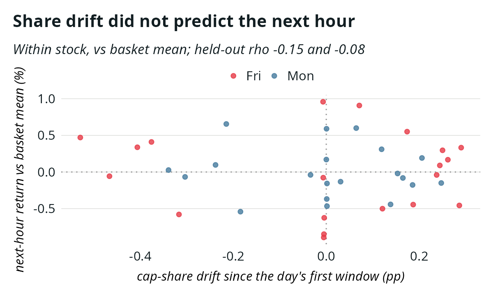
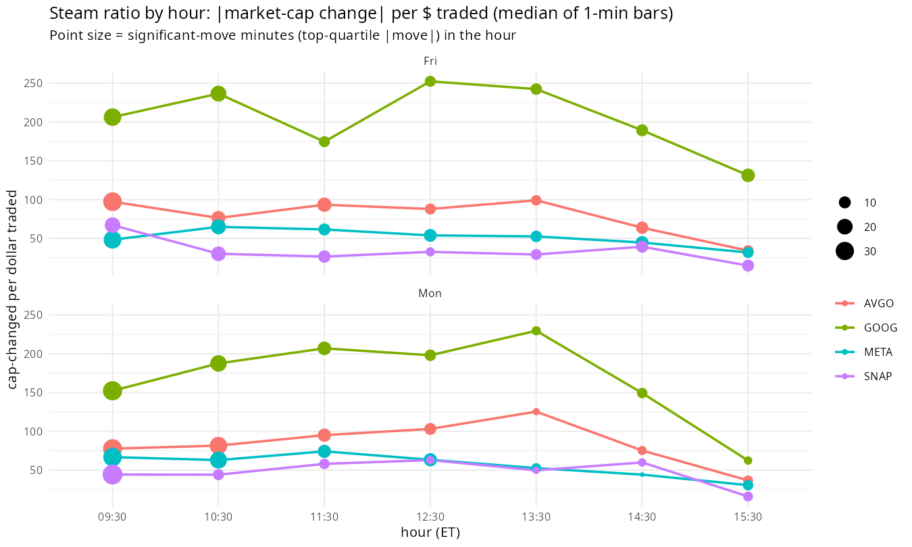

Educational market analysis. Not investment advice. All figures computed in R from Yahoo Finance v8 chart data in `data/`; scripts in `scripts/`.

## Summary

- Friday Nov 20 was a repricing, not a liquidation. The four primary stocks lost about $379B of combined market capitalization while about $44B traded. The worst minute for GOOG, META, SNAP and NVDA was 15:55; every stock closed in the bottom 3% to 9% of its day range.
- Monday Nov 23 recovered about 87% of that four-stock cap loss, arriving almost entirely as an overnight gap. AVGO erased its entire gap within 17 minutes; GOOG, META and NVDA closed above their Thursday levels.
- AVGO Friday close is 304.41, not 340.20. On the correct basis AVGO gapped up +5.40% on Monday. Details in the reconciliation section.
- Two ratios tested at hourly resolution (pre-registered tests, stated before computing Monday results):

  (a) Cap-share ratio: each stock's share of combined four-stock capitalization by hour did not pull back toward Thursday's reference weights within a session (AR(1) through the origin: coefficients 0.94 to 1.08 for seven of eight stock-days, i.e. a random walk around the reference). Deviations were small and persistent: AVGO sat 1.5 to 2.5pp below its Thursday weight and GOOG about 2pp above, on both days. Once that stock-identity effect is removed (drift measured from each day's first window, relative to the basket mean), the held-out rank correlation with the next hour's return is -0.08 and -0.15 (fit on Friday, test on Monday and the reverse); at three hours it is -0.50 and -0.38, but that rests on three independent hours per day and sits inside the band that pure noise produces. There is no usable predictive stability in the cap-share ratio at two-day, hourly resolution.

  (b) Steam ratio: holds its intra-day profile across the two opposite sessions (Spearman Friday-Monday hourly profile: AVGO 0.93, GOOG 0.86; META 0.46; SNAP 0.00). That is a structural property, not predictability. Direction test rejected (hit rate 0.479, p = 0.89). Extended to 3-4 hour windows the pooled -0.74 correlation decomposes into a day dummy, not a within-session signal.

- For practical use: the steam ratio is useful for gauging thin-book conditions (monitor each stock against its own trailing hourly median); the cap-share ratio is not a predictor at this sample size.

## Data and method

Source: Yahoo Finance v8 chart endpoint. Friday 1-minute bars for AVGO, GOOG, META, SNAP (391 bars each); Monday 1-minute bars for all five stocks (390 bars); daily bars for eight symbols Nov 16-24. Period1/period2 as computed epoch seconds; first timestamp verified to intended date for every file. NVDA excluded from cap and ratio analysis (no verified share count). Session dollars: daily volume times typical price, because 1-minute volumes do not reconcile with daily volumes across symbol-days (sum/daily ratio 0.72x to 9.85x).

Hourly windows: seven per day, labeled by their open time (09:30, 10:30, 11:30, 12:30, 13:30, 14:30, 15:30 ET). The 09:30 window covers 60 minutes; the 15:30 window covers 30 minutes including the closing auction.

v3 adds `R/11_capshare_ratio.R` (cap-share tables and AR(1)) and `R/12_capshare_corrections.R` (the predictive tests as reported below, a null simulation, and the charts). Charts use cori.charts (github::ruralinnovation/cori.charts@46cc5b7, `theme_cori()`). v2 scripts (`R/10_hourly_ratio.R` and 03/05/06/07) are unchanged.

## Reconciling the conflicting anchors

### NVDA: +31% and -1.19% are the same day

| Symbol | Fri close | Mon open | Mon close | Gap | Intraday | Close-over-close |
|---|---:|---:|---:|---:|---:|---:|
| AVGO | 304.41 | 320.86 | 313.55 | +5.40% | -2.28% | +3.00% |
| GOOG | 264.00 | 282.49 | 279.53 | +7.00% | -1.05% | +5.88% |
| META | 560.84 | 591.72 | 597.60 | +5.51% | +0.99% | +6.55% |
| SNAP | 4.55 | 4.90 | 4.92 | +7.69% | +0.41% | +8.13% |
| NVDA | 125.53 | 167.04 | 165.05 | +33.07% | -1.19% | +31.48% |
| S&P 500 | 6,910.39 | 7,227.41 | 7,237.17 | +4.59% | +0.14% | +4.73% |

NVDA's opening gap (+33.07%) was 105% of its full close-over-close move. The +31% news figure and -1.19% Yahoo daily figure measure different intervals. The gap carried the whole return before the session opened.

### AVGO: the Friday close in the brief does not reproduce

The brief gives 340.20. Yahoo's daily bar and the last 1-minute bar agree on 304.41. Friday's daily open was 343.01, its high 343.01; no AVGO bar closes between 340.00 and 340.50. Against 304.41, Monday's gap is +5.40% (up). The errata origin is unrecovered; Nicole confirmed in STATUS.md.

## Friday Nov 20: repricing without liquidation

### The recomputed table matches CONTEXT.md

| Stock | Minute | Price move | Cap change $B | $ traded M | Ratio |
|---|---:|---:|---:|---:|---:|
| AVGO | gain 09:57 | 333.30 -> 337.00 (+1.11%) | +17.65 | 61.8 | 286x |
| AVGO | loss 09:55 | 339.87 -> 331.92 (-2.34%) | -37.93 | 144.6 | 262x |
| GOOG | gain 09:31 | 271.82 -> 274.02 (+0.81%) | +27.02 | 88.2 | 306x |
| GOOG | loss 15:55 | 264.26 -> 262.50 (-0.67%) | -21.63 | 117.2 | 185x |
| META | gain 10:20 | 577.34 -> 581.38 (+0.70%) | +10.33 | 74.1 | 139x |
| META | loss 15:55 | 562.67 -> 559.53 (-0.56%) | -8.05 | 135.7 | 59x |
| SNAP | gain 15:45 | 4.53 -> 4.61 (+1.77%) | +0.14 | 2.6 | 54x |
| SNAP | loss 15:55 | 4.59 -> 4.55 (-0.87%) | -0.07 | 4.5 | 15x |

Every row reproduces the CONTEXT.md table: maximum rounded ratio difference is zero.

Close-over-close: AVGO -12.19%, GOOG -2.59%, META -5.93%, SNAP -11.13%, NVDA -14.01%, S&P 500 -3.70%. The 15:55 minute was the single largest 1-minute loss for GOOG, META, SNAP and NVDA, consistent with a closing-auction imbalance (but 1-minute bars cannot show the imbalance itself).

### Repricing, in dollars

| Stock | Day | Cap before $B | Cap after $B | Change $B | Session $ traded B | Abs change / $ traded |
|---|---:|---:|---:|---:|---:|---:|
| AVGO | Fri | 1,654 | 1,452 | -201.5 | 19.00 | 10.6x |
| AVGO | Mon | 1,452 | 1,496 | +43.6 | 12.88 | 3.4x |
| GOOG | Fri | 3,328 | 3,242 | -86.2 | 10.34 | 8.3x |
| GOOG | Mon | 3,242 | 3,433 | +190.7 | 8.74 | 21.8x |
| META | Fri | 1,526 | 1,436 | -90.6 | 14.63 | 6.2x |
| META | Mon | 1,436 | 1,530 | +94.1 | 11.30 | 8.3x |
| SNAP | Fri | 9 | 8 | -1.0 | 0.29 | 3.4x |
| SNAP | Mon | 8 | 8 | +0.6 | 0.21 | 3.0x |

The four stocks together lost about $379B on Friday; AVGO alone lost $201.5B against roughly $19B traded. The stock that changed hands repriced every unsold share with it; almost none of the lost value was converted to cash. Session dollars use daily volume because Yahoo 1-minute volumes do not reconcile.

## Monday Nov 23: what the relief rally did

All five stocks opened between +5.3% and +33.1% above Friday's close. GOOG, META and SNAP closed at 70% to 83% of their day range. AVGO opened at 320.64, hit its high of 324.44 at 09:31, fell to 304.56 at 09:47 (15 cents above Friday's close), then closed at 313.55.

| Symbol | Thu close | Fri close | Fri chg | Mon close | Fri drop retraced | Mon vs Thu |
|---|---:|---:|---:|---:|---:|---:|
| AVGO | 346.65 | 304.41 | -12.19% | 313.55 | 22% | -9.55% |
| GOOG | 271.02 | 264.00 | -2.59% | 279.53 | 221% | +3.14% |
| META | 596.22 | 560.84 | -5.93% | 597.60 | 104% | +0.23% |
| SNAP | 5.12 | 4.55 | -11.13% | 4.92 | 65% | -3.91% |
| NVDA | 145.98 | 125.53 | -14.01% | 165.05 | 193% | +13.06% |
| S&P 500 | 7,175.83 | 6,910.39 | -3.70% | 7,237.17 | 123% | +0.85% |

GOOG (221%), NVDA (193%), META (104%) more than reversed Friday's drop; SNAP retraced 65%; AVGO retraced 22%. Across the four primary stocks Monday added about $329B against Friday's loss of about $379B (87%).

## Cap-share ratio: does the equilibrium modulate at hourly resolution?

### Pre-registration, and what went wrong with its first execution

The test was written into the header of `R/11_capshare_ratio.R` before that script was run on Monday data. Claim: cap-share deviations from Thursday's reference mean-revert within sessions and predict future returns. Metric: Spearman rho. Decision rule: usable only if the held-out rho keeps its sign across days and exceeds 0.3 in absolute value. With 7 hourly windows per stock-day and 4 stocks, results are given with intervals.

Three execution errors in the first v3 pass were corrected in `R/12_capshare_corrections.R`:

- "Out-of-sample" in the first pass was each day's own in-sample rank correlation. The corrected test fits a slope on one day and scores it on the other, in both directions.
- Pooling the four stocks mixed stock identity with timing. 99.6% of the raw deviation variance is between stock-days (AVGO below its Thursday weight and GOOG above, all two days), so the raw pooled rho (0.01) measured which stock is which. Drift is now measured from each day's first window, and returns are taken relative to the four-stock mean at the same hour.
- A first fix that demeaned each day by its full-day mean used information from later in the day. Simulated with no predictability at all, it produces a mean rho of -0.42, as large as the apparent signal it first showed. The first-window baseline avoids this; its simulated mean under noise is -0.05.

### What the cap-share ratio is

Cap-share weight_i = (shares_i x price_i) / sum(shares_j x price_j). It moves whenever prices move. Thursday-close cap shares are the reference: AVGO 25.37%, GOOG 51.07%, META 23.42%, SNAP 0.13%. These are the target weights the drift-band strategy rebalances toward. The alternative reading — share-count proportion regardless of price — is fixed and cannot modulate; that failure is documented in the companion document appendix.

### Cap-share levels and deviations from Thursday reference

| Stock | Thu ref | Fri 09:30 | Fri 15:30 | Mon 09:30 | Mon 15:30 | Max abs dev (pp) |
|---|---:|---:|---:|---:|---:|---:|
| AVGO | 25.37% | 23.90% | 23.63% | 23.18% | 23.12% | 2.53 |
| GOOG | 51.07% | 52.89% | 52.84% | 53.23% | 53.09% | 2.35 |
| META | 23.42% | 23.07% | 23.41% | 23.46% | 23.66% | 0.35 |
| SNAP | 0.13% | 0.13% | 0.13% | 0.13% | 0.13% | 0.01 |

Deviations are small relative to the 4-5 percentage-point trigger: the drift-band strategy had no trigger to fire (confirmed in companion document, max drift Thu-Mon 2.24pp). AVGO's cap-share stayed below its Thursday reference for all 14 hourly windows across both sessions, deepening on Monday. GOOG's stayed above and was slowly drawn down over the two-day span. SNAP's deviations are under 0.01pp.

### AR(1): do deviations return toward the Thursday reference?

Two readings of "mean-reverting" are separated. Fitting with an intercept asks whether deviations return to the stock's own session level; fitting through the origin asks whether they return to the Thursday reference, which is the question the strategy depends on. With 7 windows there are 6 lag pairs per stock-day, so intervals use the t distribution (4 and 5 degrees of freedom), not 1.96.

| Stock | Day | Own-mean AR(1) | 95% CI | Toward-reference AR(1) | 95% CI | Half-life toward reference (hours) |
|---|---|---:|---:|---:|---:|---:|
| AVGO | Fri | 0.19 | [-0.46, 0.84] | 1.02 | [0.92, 1.12] | none (at or above 1) |
| AVGO | Mon | 0.22 | [-0.87, 1.32] | 1.00 | [0.95, 1.06] | none |
| GOOG | Fri | 0.34 | [-1.20, 1.88] | 0.99 | [0.92, 1.07] | 115 |
| GOOG | Mon | 0.90 | [-0.61, 2.41] | 0.99 | [0.95, 1.03] | 65 |
| META | Fri | 0.57 | [-0.36, 1.50] | 0.68 | [0.34, 1.03] | 1.8 |
| META | Mon | 0.61 | [0.16, 1.05] | 1.08 | [0.78, 1.39] | none |
| SNAP | Fri | 0.24 | [-0.21, 0.69] | 1.07 | [0.68, 1.46] | none |
| SNAP | Mon | 0.25 | [-0.86, 1.36] | 0.94 | [0.79, 1.09] | 12 |

Toward the Thursday reference, seven of eight coefficients have intervals containing 1 (a random walk) and the point estimates run 0.94 to 1.08. The exception is META on Friday (0.68, half-life about 1.8 hours, interval 0.34 to 1.03), the one stock whose weight sat on the reference. Around its own session level, the hourly wobble in cap share is short-lived (point estimates 0.19 to 0.90, mostly below 0.6), but those wobbles are a few hundredths of a percentage point and are not evidence of a pull toward the Thursday weights. AVGO's and GOOG's offsets from the reference did not decay on either day. The earlier statement that "every interval includes both zero and one" was wrong; it is replaced by this table.

_Deviation from the Thursday-close cap share, percentage points; solid Friday, dashed Monday. The offsets are persistent and larger than any hourly movement around them._

### Predictability: corrected results

Drift is the change in a stock's cap-share weight since the day's first window; the outcome is the next-hour (or next-three-hour) return minus the four-stock mean at the same hour. A slope is fit on one day and scored on the other. The "noise band" is the 5th to 95th percentile of the held-out-style rho when 28 hourly returns are independent random draws with no predictability.

| Window | Fit on | Test on | Held-out rho | OOS R-squared vs zero forecast | Hours per day | Noise band (5th to 95th) |
|---|---|---|---:|---:|---:|---|
| Next 1h | Fri | Mon | -0.15 | 0.006 | 5 | -0.42 to +0.36 |
| Next 1h | Mon | Fri | -0.08 | 0.006 | 5 | -0.42 to +0.36 |
| Next 3h | Fri | Mon | -0.50 | 0.12 | 3 | -0.68 to +0.58 |
| Next 3h | Mon | Fri | -0.38 | 0.20 | 3 | -0.68 to +0.58 |

At one hour, the held-out rho is -0.15 and -0.08, below the 0.3 threshold, and the forecast explains 0.6% of next-hour variance. At three hours the rho is -0.50 and -0.38, same sign both ways and above 0.3, so the pre-registered rule as written is met at three hours. It should not be read as a finding. Each day contributes three independent hours (the four stocks share them), and pure noise produces an absolute rho of 0.38 or more in 38% of simulated draws and 0.50 or more in 23%. A threshold of 0.3 sits well inside the noise band at this sample size, so the rule was too weak to be a test; the bootstrap intervals for the 3-hour rho, resampling hours, run from -0.80 to +0.60 on Friday and -0.80 to +0.40 on Monday. The answer stated plainly: no usable predictive stability in the cap-share ratio at two-day, hourly resolution. The sign is negative in all four cases, which is the direction a rebalancer would want, and two days cannot say more. The correct use of cap-share weights in this strategy is as rebalancing targets, not signals.

_Cap-share drift since the day's first window against the next-hour return relative to the basket, one point per stock-hour. The cloud has no visible slope._

## Steam ratio: hourly stability and predictability

This section reproduces v2's findings and adds the 3-4 hour window extension. All in `R/10_hourly_ratio.R` (steam ratio, four figures from v2) and `R/11_capshare_ratio.R` (3-4h window tables, v3).

### Finding 1: the amplification is per-stock structure; its intra-day profile repeats

| Stock | Spearman rho(Fri hourly, Mon hourly) | CV Fri | CV Mon | Median Fri | Median Mon |
|---|---:|---:|---:|---:|---:|
| AVGO | 0.93 | 0.34 | 0.36 | 77x | 82x |
| GOOG | 0.86 | 0.22 | 0.37 | 207x | 177x |
| META | 0.46 | 0.21 | 0.27 | 52x | 66x |
| SNAP | 0.00 | 0.34 | 0.30 | 32x | 51x |

The hourly ratio profiles track each other across two sessions with opposite moods for AVGO (0.93) and GOOG (0.86). Within any single hour the minute-level ratio has a coefficient of variation of 0.76 to 1.08; stability exists only at hourly aggregation. Event-conditioned medians (top-quartile moves) run 2.4x to 2.8x the hour's baseline on both days.

_Steam ratio (median of 1-minute ratios) per hour, per stock, Friday and Monday. The shape of the intra-day profile repeats with high rank-correlation for AVGO and GOOG despite the two sessions having opposite outcomes._

### Finding 2: what changed was the flow, not the vessel

Monday ran roughly 2x Friday's dollar volume with the multipliers essentially unchanged (within 10% for AVGO, META, SNAP; GOOG 25% lower on its calmer session). The larger session capitalization changes were produced by more flow through the same amplifier. In the steam framing: the vessel's amplification is a constant of how the market is plumbed; a crisis changes how hard the steam pushes, not the size of the piston.

### Finding 3: it does not predict hour-to-hour direction (tested, rejected)

Signed volume imbalance per hour as a Spearman predictor of next-hour return, pooled across 8 symbol-days (n = 48 hour-pairs).

- Pooled directional hit rate: 0.479 (binomial p = 0.89 against coin-flip).
- Per-symbol Spearman(imb, next_ret): AVGO +0.09, GOOG -0.37, META -0.02, SNAP -0.58 — mixed signs at 12 windows per symbol.

_Steam-ratio directional test: signed volume imbalance in hour t vs next-hour return. No trend; coin-flip hit rate (p = 0.89)._

### Finding 4: 3-4 hour window extension

| Scope | Spearman(3h imbalance, next 1h) | Spearman(3h imbalance, next 3h) |
|---|---:|---:|
| Pooled (n=24) | -0.60 | -0.74 |
| Friday only (n=12) | -0.13 | -0.22 |
| Monday only (n=12) | -0.08 | -0.34 |

The pooled -0.74 looks like a signal and is not. Within each day the correlation is under 0.35. The pooled result is a day dummy: Friday morning windows were net-sell and Friday fell; Monday morning windows were net-buy and Monday rose. That is one intraday-persistence observation counted twelve times. No resolution of minute data fixes this; it needs more sessions, not finer bars.

### Design consequence for the trading harness

The expansion-ratio monitor should baseline each stock against its own trailing hourly median, not against another stock or a crisis day. That monitor requires a 20-plus session panel of hourly ratios to establish baselines; this two-session analysis confirms the structural property but cannot supply the baselines.

## What Monday did not repair

AVGO ended Monday 9.55% below Thursday's close. By a Tuesday mid-session snapshot at about 13:50 ET (not a close), AVGO was -3.08% from Monday's close — back within 0.17% of Friday's close. NVDA was -6.95% from Monday's close at the same snapshot. The high-beta names gave back Monday's gains faster than the others.

| Date | VIX open | VIX close | 10-year close (%) |
|---|---:|---:|---:|
| 2026-11-16 | 20.00 | 22.91 | 5.121 |
| 2026-11-19 | 22.06 | 28.44 | 5.052 |
| 2026-11-20 | 28.63 | 35.89 | 4.912 |
| 2026-11-23 | 31.38 | 26.62 | 4.918 |

Monday's close: VIX 26.62 and 10-year 4.918% are inside the harness's "contained" band (VIX under 30, 10-year under 5%). Friday's close was in the "boiling" band (VIX 30-40 or 10-year at or above 5%). Containment describes the gauge, not the stocks. VIX Monday intraday low of 15.39 appears anomalous against a 31.38 open and 26.62 close; left as-is from the data, unverified.

## Reading the rest of Thanksgiving week

Calendar facts are from CONTEXT.md, not independently verified: Tuesday consumer confidence; Wednesday core PCE (expected +0.3% m/m) with GDP, durable goods and jobless claims 08:15-10:30 ET; Thursday Nov 26 closed; Friday Nov 27 early close.

- Gaps carry the information. On both days most of the move came overnight. A strategy that observes only during the session sees the aftermath.
- Monday's fade in AVGO and NVDA, and Tuesday's continuation, suggest the relief rally repaired the most extreme dislocations, not a full re-rating of the group.
- The steam ratio is high in any thin-volume window. A half-day on Friday and a pre-holiday Wednesday have lower dollar volume, so the same price change will carry more capitalization change per dollar traded.
- The harness gauge: VIX 26.62 and 10-year 4.92% at Monday's close are in the "contained" band; Friday (VIX 35.89) was "boiling".

## Data quality and limits

| Stock | Day | Sum of 1m volume (M) | Daily volume (M) | Ratio | Largest 1m bar (M) |
|---|---:|---:|---:|---:|---:|
| AVGO | Fri | 73.5 | 60.1 | 1.22 | 29.2 |
| AVGO | Mon | 93.1 | 41.0 | 2.27 | 26.1 |
| GOOG | Fri | 27.8 | 38.5 | 0.72 | 1.3 |
| GOOG | Mon | 29.6 | 31.4 | 0.94 | 3.8 |
| NVDA | Fri | 2,892.7 | 633.4 | 4.57 | 362.3 |
| NVDA | Mon | 7,672.9 | 779.2 | 9.85 | 608.9 |

The 1-minute volumes do not reconcile with Yahoo's daily volumes. The ratio of summed 1-minute volume to daily volume runs 0.72x to 9.85x, driven by a small number of oversized bars. Session dollars use daily volume times typical price for this reason. NVDA has no verified share count and is excluded from cap and ratio analysis. Monday's 1-minute bars end at 15:59; closes use the daily bar.

## Reproducibility

- v2 scripts (unchanged): `R/10_hourly_ratio.R`, `R/03_analysis.R`, `R/05_tables_doc1.R`, `R/06_extras_doc1.R`, `R/07_sums_doc1.R`.
- v3 additions: `R/11_capshare_ratio.R` (cap-share tables, first-pass AR(1) and predictive tests, superseded where noted) and `R/12_capshare_corrections.R` (corrected AR(1), true out-of-sample tests, null simulation, charts).
- Raw data: `data/*_20261123_1m.json`, `data/NVDA_20261120_1m.json`, `data/*_daily_*.json`, `AVGO.json`, `GOOG.json`, `META.json`, `SNAP.json`.
- Computed outputs: `data/capshareratio_hourly.csv`, `data/capshareratio_ar1_v3fix.csv`, `data/capshareratio_oos_true.csv`, `data/capshareratio_within_tests.csv`, `data/capshareratio_predict.csv`, `data/hourly_ratio.csv`, `data/hourly_stability.csv`, `data/hour_to_hour_predict.csv`, `data/hour3_predict.csv`.
- v3 is `docs/selloff-nov20-recovery-nov23-v3.qmd`; v2 (`-v2.qmd`) and v1 (`.qmd`) are preserved.
- Educational analysis of publicly reported prices. Not investment advice.
